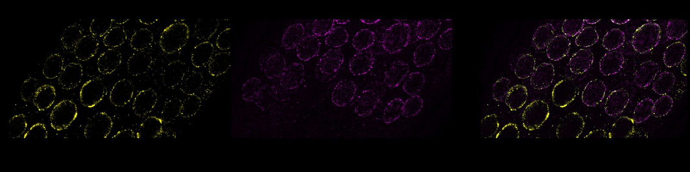
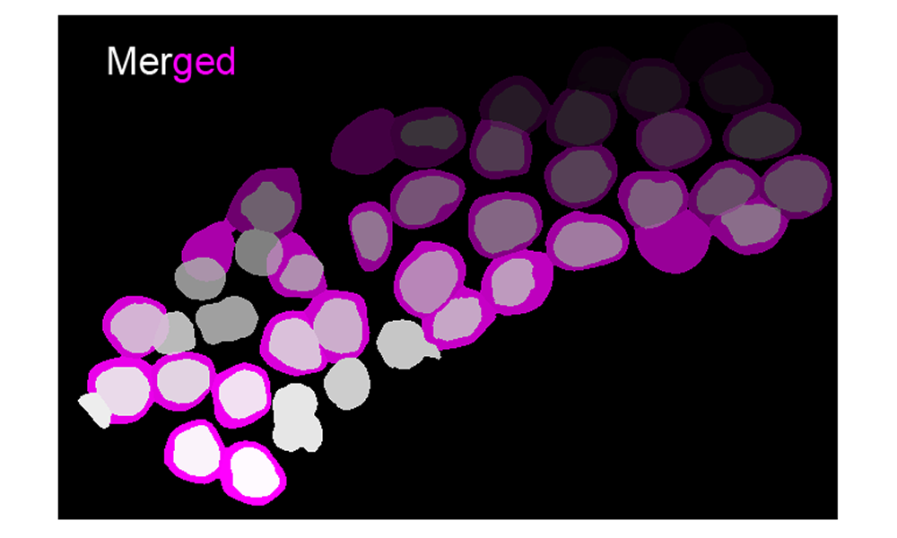
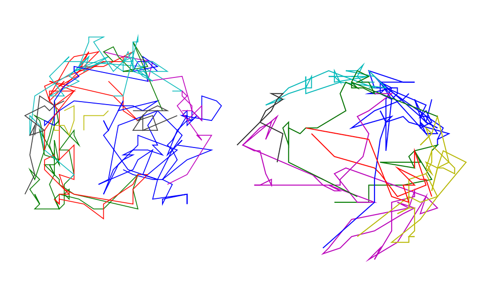
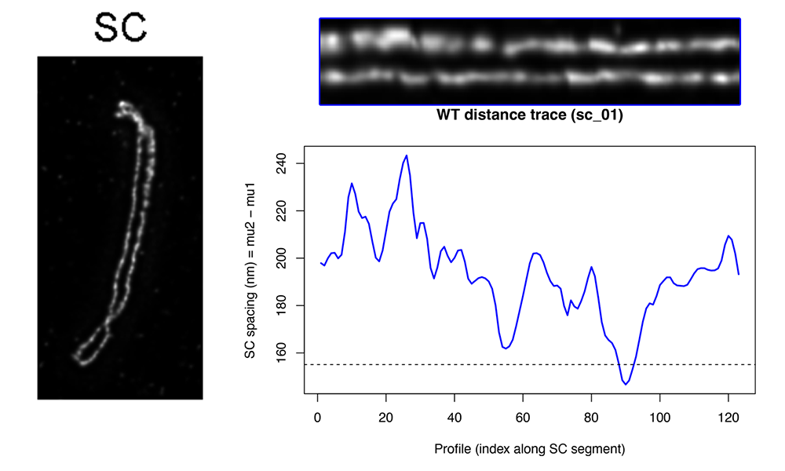
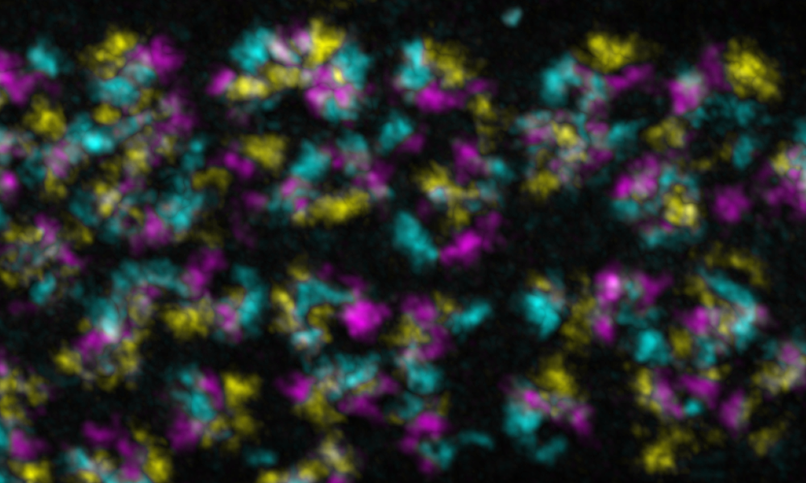

<!--
GitHub profile README for:
https://github.com/antoinebaudrimont-beep

Recommended:
1. Add a banner image as assets/banner.png
2. Add project preview images under assets/
3. Keep images reasonably small so the page loads quickly
-->

  

<h1 align="center">Antoine Baudrimont</h1>

  <strong>Molecular Biology · Quantitative Microscopy · Image & Data Analysis</strong>

  Molecular and cell biologist working at the interface between
  <strong>experimental biology</strong>,
  <strong>microscopy</strong> and
  <strong>quantitative analysis</strong>.

  
  
  
  
  
  

---

## About me

I am a molecular and cell biologist with a research background in **chromosome biology, meiosis and genome integrity**.

Alongside experimental biology, I develop reproducible computational workflows to extract quantitative information from microscopy and biological datasets.

My work combines **Python, R, Fiji/ImageJ, Napari and machine-learning-based image segmentation** with biological experiment design and interpretation.

My main interest is bridging the gap between:

  <strong>Microscopy</strong>
  &nbsp;→&nbsp;
  <strong>Segmentation</strong>
  &nbsp;→&nbsp;
  <strong>Quantification</strong>
  &nbsp;→&nbsp;
  <strong>Statistics</strong>
  &nbsp;→&nbsp;
  <strong>Biological interpretation</strong>

---

## Research & analysis

- Quantitative fluorescence microscopy
- Image segmentation and object-based analysis
- Live-cell imaging and particle tracking
- 3D image analysis and colocalization
- Super-resolution microscopy analysis
- Biological data processing and visualization
- Reproducible research workflows

---

## Selected research software

<table>
<tr>

<td width="50%" valign="top">

### SUN-1 / DAPI overlap analysis

  

Cellpose-based Python pipeline for segmentation and quantitative analysis of DAPI overlap within SUN-1-labelled structures.

**Python · Cellpose · Microscopy · Segmentation**

[View repository →](https://github.com/antoinebaudrimont-beep/sun1-dapi-overlap-analysis-pipeline)

</td>

<td width="50%" valign="top">

### SUN-1 aggregate tracking

  

R workflow for analysing live-imaging tracks of SUN-1 aggregates, including trajectories, velocity, explored area and split/fusion events.

**R · Live imaging · Tracking · Quantification**

[View repository →](https://github.com/antoinebaudrimont-beep/sun1_aggregate_tracking_analysis)

</td>

</tr>

<tr>

<td width="50%" valign="top">

### STED synaptonemal complex spacing

  

Quantitative analysis of STED microscopy intensity profiles using Gaussian peak fitting to measure synaptonemal-complex spacing.

**R · STED · Gaussian fitting · Meiosis**

[View repository →](https://github.com/antoinebaudrimont-beep/sted_synaptonemal_complex_spacing)

</td>

<td width="50%" valign="top">

### 3D chromosome colocalization

  

Python workflow for measuring pairwise voxel overlap between segmented 3D chromosome masks.

**Python · Napari · 3D imaging · Colocalization**

[View repository →](https://github.com/antoinebaudrimont-beep/chromosome_mask_colocalization_analysis)

</td>

</tr>
</table>

---

## Additional research tools

### DDK meiotic resection analysis

Microscopy-based analysis workflows developed for studying Dbf4-dependent kinase function during meiotic DNA end resection in *Caenorhabditis elegans*.

**Python · C. elegans · Meiosis · DNA repair · Microscopy**

[View repository →](https://github.com/antoinebaudrimont-beep/ddk-meiotic-resection-analysis)

### DeltaVision stack projection tools

Fiji/ImageJ and Python utilities for preprocessing multi-channel DeltaVision microscopy stacks and generating background-subtracted TIFF projections.

**Python · Fiji/ImageJ · DeltaVision · Image preprocessing**

[View repository →](https://github.com/antoinebaudrimont-beep/dv_stack_projection_tools)

---

## Technical toolkit

**Scientific computing**

`Python` · `R` · `NumPy` · `pandas` · `SciPy` · `matplotlib`

**Image analysis**

`Fiji/ImageJ` · `Napari` · `Cellpose` · `3D image analysis` · `object segmentation`

**Biological imaging**

`Fluorescence microscopy` · `Live imaging` · `STED` · `DeltaVision`

**Environment**

`Linux` · `Git` · `GitHub` · `Jupyter`

---

## Personal software projects

I work on applications that solve practical problems in everyday computer use. My contribution centres on defining interfaces and expected behaviour, directing AI-assisted implementation, and testing installation, usability, and interaction with other software.

### mpv-radio-tray

An internet radio player for Linux and macOS, with saved station settings, audio-output selection, and recovery from interrupted playback. It uses mpv on Linux and native audio playback on macOS. The repository documents installation, configuration, testing, and known limitations.

**Project technologies:** Python · Swift · Linux · macOS

[View repository →](https://github.com/antoinebaudrimont-beep/mpv-radio-tray)

### walite

A lightweight, keyboard-driven, unofficial WhatsApp client for Linux and macOS terminals. Features include messaging, quoted replies, persistent local chat caching, configurable themes, and desktop notifications. The repository documents installation, upgrades, and rollback procedures.

**Project technologies:** Go · SQLite · Linux · macOS

[View repository →](https://github.com/antoinebaudrimont-beep/walite)
---

  <em>Biological questions first. Quantitative tools where they help answer them.</em>

